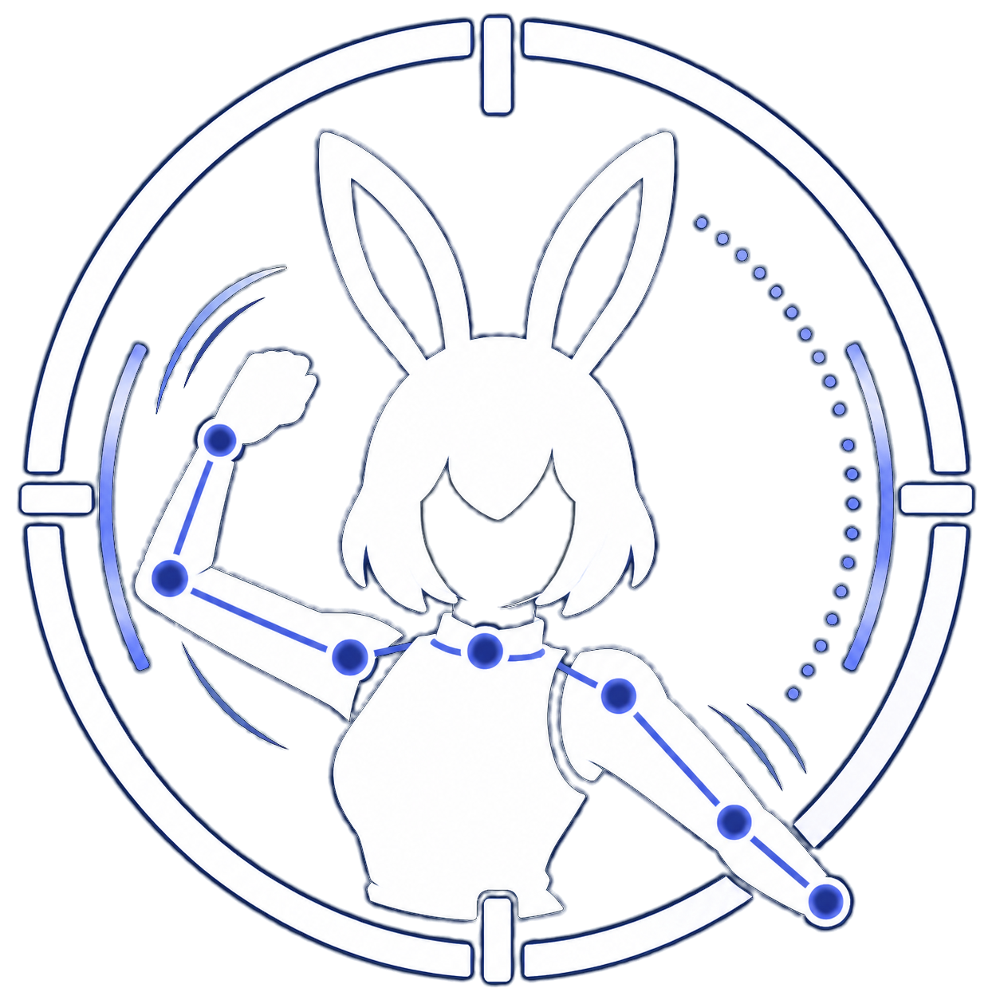

  

# U.N. Motion

Webカメラで、アバターに自分の表情と動きを。U.N. Motion は顔・手・全身の動きを捉え、U.N. Avatar や VMC 対応アプリへリアルタイムに送るモーションキャプチャアプリです。

[公式サイト](https://usagi.github.io/un-motion/) · [Windows版をダウンロード](https://github.com/usagi/un-motion/releases/latest) · [操作ガイド](docs/operation-guide.md)

## はじめかた

ZIPをすべて展開し、`un-motion-supervisor.exe` を起動します。「プロファイルと稼働」でカメラと出力先を選び、「このプロファイルを起動」。同じPCのU.N. AvatarにはUNMF/Zで接続できます。

顔は別のアプリから、体と手はWebカメラから。複数のプロファイルを同時に動かして、部位ごとに入力や補正を選べます。気に入ったポーズやモーションは記録して再生できます。

[カメラの選び方](docs/operation-guide.md#カメラについて) · [設定と接続](docs/operation-guide.md#一般的な使い方) · [開発者向け](docs/development-guidelines.md)

## License

[MIT](LICENSE)

Third-party components keep their own licenses. See [THIRD_PARTY_NOTICES.md](THIRD_PARTY_NOTICES.md).

## Author

[usagi / USAGI.NETWORK](https://usagi.network)
